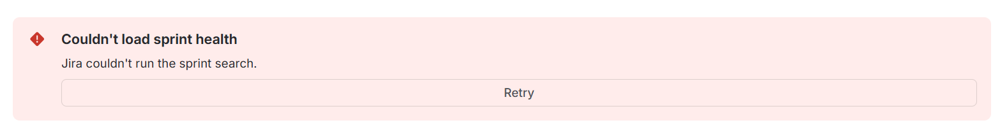
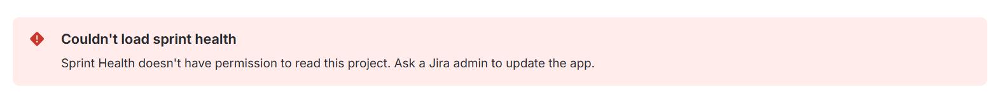
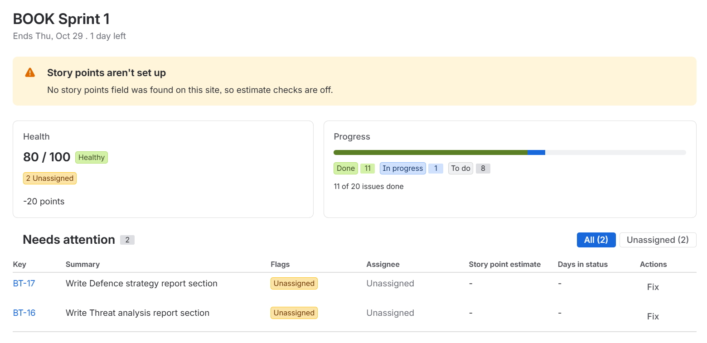
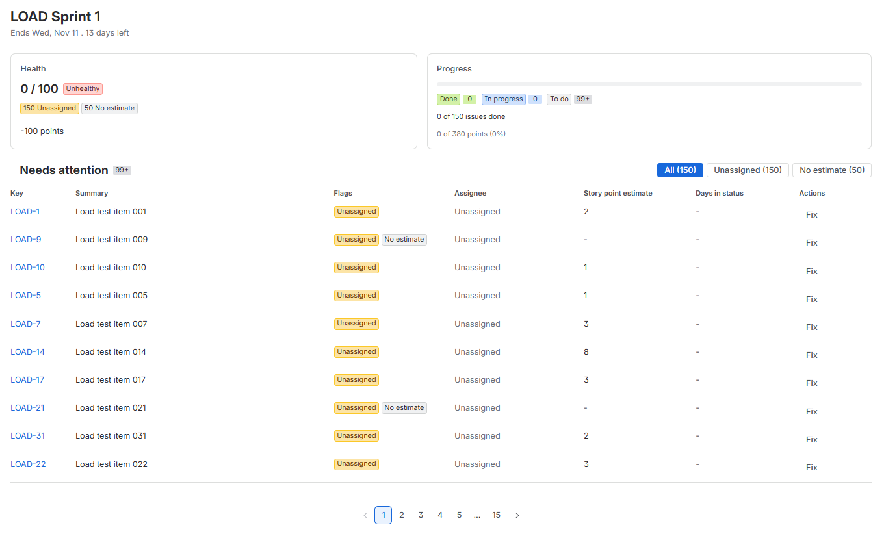
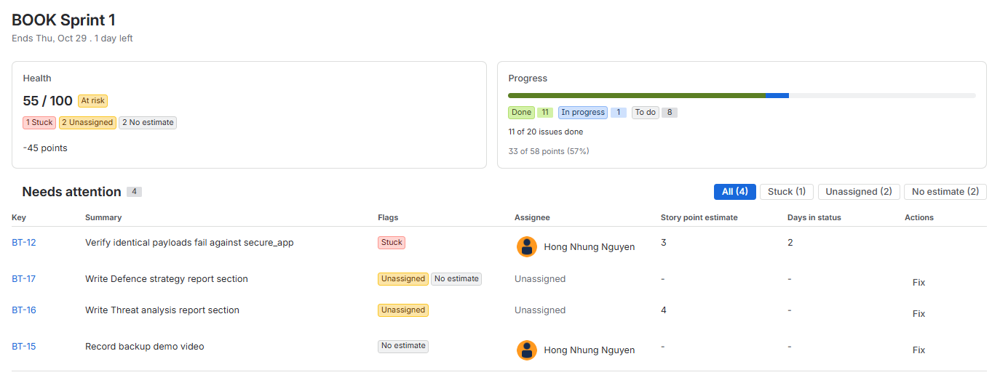
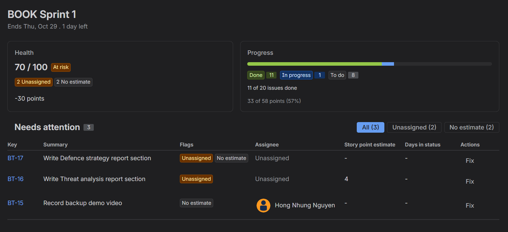
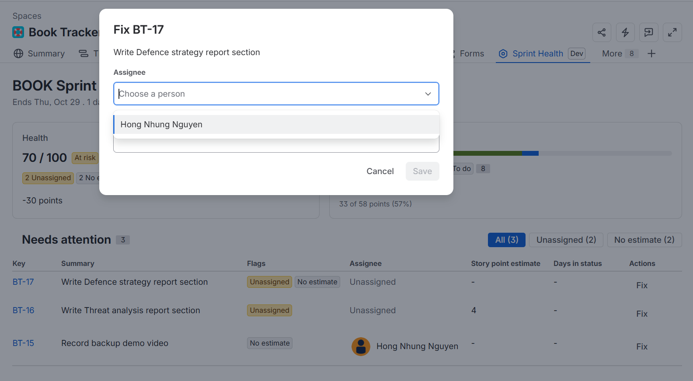

# Test report

Manual and end-to-end test results for Sprint Health. Unit tests run with `npm test` and in CI. This file
records what was checked by hand in Jira.

- **Site:** honhu2ng.atlassian.net (sections #27–#33 and Fix in place: development environment;
  #34: production)
- **Test spaces:**
  - **BT** (Book Tracker): 20 work items, matches [`expected-results.md`](expected-results.md)
  - **LOAD** (Load Test): 150 work items from [`load-test-150.csv`](load-test-150.csv)
- **Screenshots:** [`docs/screenshots/`](screenshots/)

How to read the tables: **Expected** is worked out before testing, **Actual** is what the app showed,
and **Pass** is ✅ or ❌. Every ❌ links to a bug issue.

## Summary

| Section                                        | Result |
| ---------------------------------------------- | ------ |
| #28 Error handling                             | ✅     |
| #27 Site without a story points field          | ✅     |
| #29 Large sprint: pagination and performance   | ✅     |
| #30 Manual test pass against expected results  | ✅     |
| #31 Scenario tests                             | ✅     |
| #32 Permissions and other spaces               | ✅     |
| #33 UI check                                   | ✅     |
| Fix in place                                   | ✅     |
| #34 Production deploy                          | ✅     |

---

## #28 Error handling

| Check       | How                         | Expected                                       | Pass |
| ----------- | --------------------------- | ---------------------------------------------- | ---- |
| Bad request | JQL with `AND AND`          | "Jira couldn't run the sprint search." + Retry | ✅   |
| Retry       | Fix the JQL, click Retry    | Spinner, then the panel                        | ✅   |
| Forbidden   | Simulated `jiraStatus: 403` | Permission message, no Retry                   | ✅   |
| Unknown     | Simulated `jiraStatus: 500` | "Couldn't load sprint health." + Retry         | ✅   |

**Note:** an unknown JQL function (e.g. `openSprintz()`) returns no results rather than an error, so it
shows "No active sprint". Only syntax errors produce a 400.

---

## #27 Site without a story points field

**How:** the resolver temporarily set `storyPoints: null` after looking up the field IDs.

| Check    | Expected                                           | Pass |
| -------- | -------------------------------------------------- | ---- |
| Warning  | "Story points aren't set up" message               | ✅   |
| Flags    | No "No estimate" flags                             | ✅   |
| Progress | Based on issue count; no points line               | ✅   |
| Score    | 80 / 100 🟢 Healthy (only the 2 unassigned issues) | ✅   |

---

## #29 Large sprint: pagination and performance

**Setup:** LOAD space, one active sprint containing all 150 items from `load-test-150.csv`
(all To Do, all unassigned, 50 with no estimate, 380 points in total).

| Check                                          | Expected                                                       | Actual                                         | Pass |
| ---------------------------------------------- | -------------------------------------------------------------- | ---------------------------------------------- | ---- |
| Issues fetched (tunnel log `fetched N issues`) | 150 (2 search pages: 100 + 50)                                 | 150                                            | ✅   |
| Progress                                       | 0 of 380 points done (0%) · To do 150 · In progress 0 · Done 0 | 0 of 380 points done (0%)                      | ✅   |
| Score                                          | 0 / 100 🔴 Unhealthy (not negative)                            | 0 / 100                                        | ✅   |
| Breakdown                                      | −1500 unassigned (150) · −250 unestimated (50)                 | −1500 unassigned (150) · −250 unestimated (50) | ✅   |
| Needs attention                                | (150), 10 rows per page, 15 pages                              | 150 (10 rows, 15 pages)                        | ✅   |
| Resolver time, tunnel (local)                  | < 5 s                                                          | 940 ms                                         | ✅   |
| Resolver time, deployed, first load            | < 5 s                                                          | 2.3 s                                          | ✅   |
| Resolver time, deployed, later load            | < 5 s                                                          | 880 ms                                         | ✅   |

---

## #30 Manual test pass against expected results

**Setup:** BT space. Values from [`expected-results.md`](expected-results.md).

### Run 1: `STUCK_DAYS = 3` (default)

| Check           | Expected                                           | Actual        | Pass |
| --------------- | -------------------------------------------------- | ------------- | ---- |
| Sprint name     | BOOK Sprint 1                                      | BOOK Sprint 1 | ✅   |
| Days left       | Within 1 day of Jira's "days remaining"            | 2             | ✅   |
| Progress counts | 20 total · To do 8 · In progress 1 · Done 11       | Same          | ✅   |
| Points          | 33 of 56 points done (59%)                         | Same          | ✅   |
| Score           | 70 / 100 🟡 At risk                                | Same          | ✅   |
| Breakdown       | −20 unassigned (2) · −10 unestimated (2)           | Same          | ✅   |
| Needs attention | BT-14, BT-15 Unassigned · BT-16, BT-17 No estimate | Same          | ✅   |
| Issue links     | Clicking a key opens the issue                     | Same          | ✅   |

### Run 2: `STUCK_DAYS = 0`

| Check     | Expected                                                 | Actual | Pass |
| --------- | -------------------------------------------------------- | ------ | ---- |
| Score     | 55 / 100 🟡 At risk                                      | Same   | ✅   |
| Breakdown | −15 stuck (1) · −20 unassigned (2) · −10 unestimated (2) | Same   | ✅   |
| First row | BT-12, Stuck, with days in status shown                  | Same   | ✅   |

---

## #31 Scenario tests

**Setup:** BT space, `STUCK_DAYS = 0`. Each change is undone after the check unless noted.

| #   | Action in Jira                               | Expected on the panel                                           | Pass |
| --- | -------------------------------------------- | --------------------------------------------------------------- | ---- |
| 1   | Assign BT-14                                 | Its Unassigned flag disappears; score +10                       | ✅   |
| 2   | Add story points to BT-16                    | Its No estimate flag disappears; score +5; points totals update | ✅   |
| 3   | Move a To Do item to Done                    | It's not in the table; progress % goes up                       | ✅   |
| 4   | BT-12 in progress for more than `STUCK_DAYS` | Stuck flag shown at the top                                     | ✅   |
| 5   | Fix every flag                               | All clear 🎉 · 100 / 100 🟢 Healthy · no table                  | ✅   |
| 6   | Complete the sprint (test space, not BT)     | "No active sprint" empty state                                  | ✅   |

---

## #32 Permissions and other spaces

| Check                                    | Expected                                    | Pass |
| ---------------------------------------- | ------------------------------------------- | ---- |
| Non-admin user opens Sprint Health in BT | "Allow access" prompt, then correct numbers | ✅   |
| A second Software space                  | Shows that space's own sprint data          | ✅   |
| A Business space                         | No crash: no tab, or a friendly message     | ✅   |

---

## #33 UI check

| Check                  | Expected                                                   | Pass |
| ---------------------- | ---------------------------------------------------------- | ---- |
| Dark theme             | Text, Lozenges, card borders and the progress bar readable | ✅   |
| Light theme            | Same                                                       | ✅   |
| Narrow window (~800px) | Cards and filters wrap cleanly, table usable               | ✅   |
| Browser console        | No errors or `XCSS` / `Heading` warnings from the app      | ✅   |

**Note:** the console also shows Jira's own messages (Sentry 429, `mypreferences` 404,
`DEPRECATED JS`, `FeatureGateClients`, `IndexedDB timed out`). They appear on every Jira page and
don't come from the app.

---

## Fix in place

**Setup:** BT space, `STUCK_DAYS = 3`. Each change is undone in Jira afterwards.

| #   | Action                                          | Expected                                                     | Pass |
| --- | ----------------------------------------------- | ------------------------------------------------------------ | ---- |
| 1   | Fix BT-14: pick an assignee, Save               | Row disappears; score 70 → 80; Unassigned filter count 2 → 1 | ✅   |
| 2   | Fix BT-16: enter `3`, Save                      | Row disappears; score +5; points total +3                    | ✅   |
| 3   | Unassign BT-16 in Jira, then Fix                | Dialog shows both fields                                     | ✅   |
| 4   | In that dialog, fill only the assignee, Save    | Unassigned Lozenge goes; No estimate stays; row stays        | ✅   |
| 5   | Enter `-2` or `abc` for points                  | Red hint; Save disabled                                      | ✅   |
| 6   | Cancel or Esc                                   | Dialog closes; nothing changes                               | ✅   |
| 7   | Stuck row (`STUCK_DAYS = 0`)                    | No Fix button                                                | ✅   |
| 8   | Filter: click **Unassigned**                    | Only unassigned issues listed; button turns blue             | ✅   |
| 9   | Fix the last issue while its filter is selected | Filter button disappears; table goes back to All             | ✅   |

---

## #34 Production deploy

- **Environment:** production · **Version:** 2.0.0 · **Date:** 29 Oct 2026
- **Site:** honhu2ng.atlassian.net (development install removed)

| Check                      | Expected                                    | Pass |
| -------------------------- | ------------------------------------------- | ---- |
| No "(DEVELOPMENT)" label   | Tab shows "Sprint Health"                   | ✅   |
| Allow access, then panel   | Consent prompt lists all 3 scopes           | ✅   |
| BT numbers                 | 70 / 100 At risk · 33 of 56 points · 4 rows | ✅   |
| Fix in place               | BT-14 fixed, score 80, then undone          | ✅   |
| LOAD sprint                | 150 issues, 15 pages, under 5 s             | ✅   |
| `forge logs -e production` | No errors                                   | ✅   |
